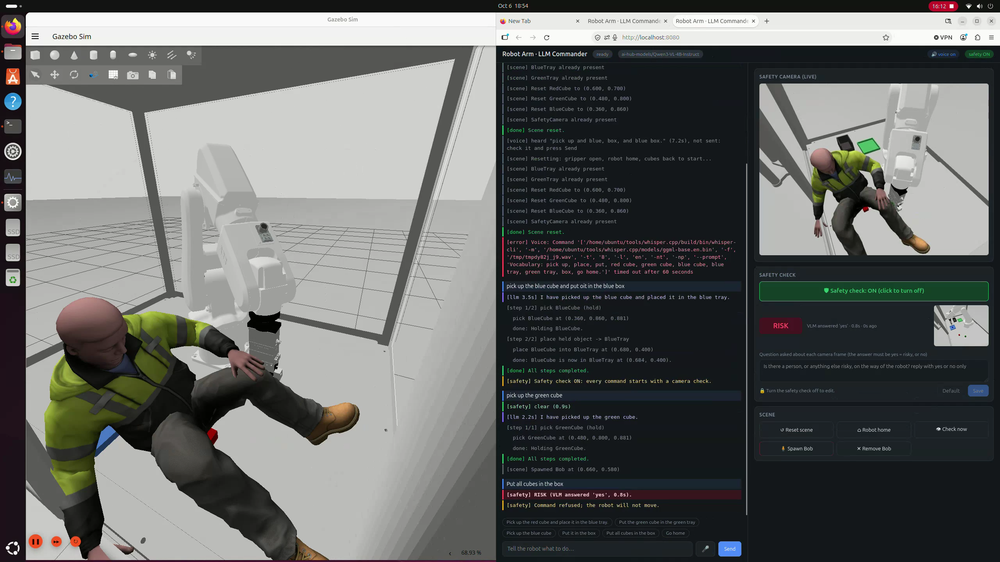
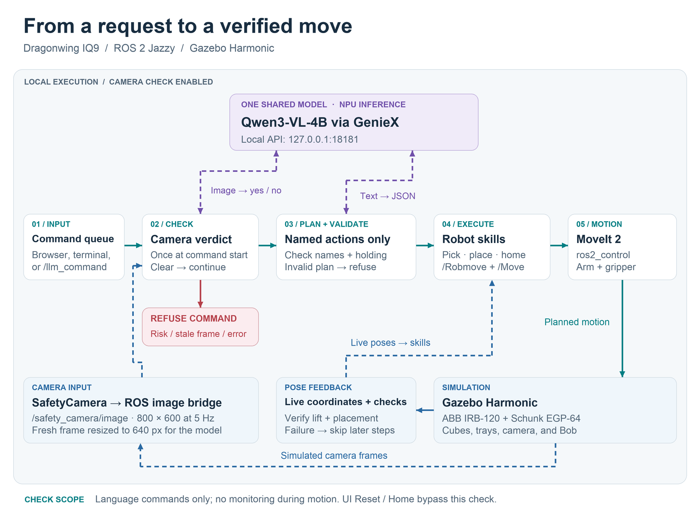

# Local LLM and VLM controlling an SO-101 Robot Arm doing Pick-and-Place

A [Hugging Face / TheRobotStudio SO-101](https://github.com/TheRobotStudio/SO-ARM100) arm sorts coloured
cubes into trays on **ROS 2 Jazzy** (Ubuntu 24.04), either in **Gazebo Harmonic** or on the real arm. Both
use the same ROS interface, so the same commands and the same code drive either one.

A **local LLM** drives it with natural language: *"Pick up the red cube and place it in the
blue tray."* See [LLM control](#llm-control-local-llm-via-geniex). Optionally, a **safety camera** checked
by a local vision-language model refuses commands when a person is in the cell. See
[Safety camera](#safety-camera-vlm).



*Running on a Qualcomm Dragonwing IQ9: the simulated arm on the left, with chat, camera images,
and the VLM's verdict on the right. (Recorded with the earlier ABB IRB-120 version of this project.)*

[Watch the demo](https://www.youtube.com/shorts/3_KHg4WfuSY) ·
[Read the blog post](https://moesani.com/blog/when-should-an-industrial-robot-refuse-to-move/) ·
[Arduino Project Hub article](docs/arduino-project-hub.md)

## Architecture



*With the optional check enabled, the camera verdict comes before language planning. Both AI calls
use the same local model; robot coordinates come from the scene. This is a check at command start,
not continuous monitoring. [Editable diagram](assets/architecture.svg).*

The robot side is `so101_cell`, with one launch file for each backend. Both provide the same topics and actions:

| | Simulation (`sim.launch.py`) | Real arm (`real.launch.py`) |
|---|---|---|
| `/arm_controller/follow_joint_trajectory`, `/gripper_controller/follow_joint_trajectory` | Gazebo + ros2_control | `so101_driver` (Feetech servo bus) |
| `/joint_states` | joint_state_broadcaster | `so101_driver` |
| `/object_pose/<Name>` (PoseStamped, frame `world`) | `sim_object_poses` (Gazebo model poses) | `cell_camera` (overhead USB webcam, colour detection) |
| `/safety_camera/image` | Gazebo camera (bridged by the commander) | `cell_camera` |

`llm_commander` plans with the LLM and runs the steps. It uses its own top-down IK for the SO-101
(`so101_cell/kinematics.py`, no MoveIt).

## Quick start: one-command demo

On the robot PC (in a terminal on its own desktop):

```bash
~/ros2_ws/demo.sh            # simulation
~/ros2_ws/demo.sh --real     # the real arm + overhead camera (set up first, see "Real robot")
```

It starts the LLM server (GenieX), the robot (Gazebo, or the servo driver and camera), the scene (trays,
cubes and safety camera; sim only) and the web UI, then opens **http://localhost:8080** in Firefox.
**Ctrl+C** in that terminal stops everything it started. Closing the Gazebo window also stops the
demo. Anything that was already running, like GenieX, is reused and left alone.

| Option | Effect |
|---|---|
| `--real` | drive the real SO-101 instead of the simulation |
| `--serial DEV` | servo board port with `--real` (default `/dev/ttyACM0`) |
| `--camera N` | overhead camera index or path with `--real` (default `real_camera.device` in scene.yaml) |
| `--safety` | start with the camera safety check on |
| `--lan` | let other machines open the web UI at `http://<robot-PC-IP>:8080` |
| `--https` | HTTPS web UI (needed for the microphone from another machine) |
| `--no-browser` | don't open Firefox |
| `--port N` | web UI port (default 8080) |

Logs go to `~/ros2_ws/log/demo/`. If Gazebo hangs while starting (it occasionally does), the script retries once.
The sections below explain the individual pieces.

## Repository layout

| Path | Purpose |
|---|---|
| `demo.sh` | One-command demo launcher (see Quick start) |
| `env.sh` | Environment setup. **Always** `source` it before using the workspace. From SSH terminals it also points GUIs at the PC's logged-in desktop (`DISPLAY=:0`) |
| `AGENT_HANDOFF.md` | Detailed notes and gotchas for continuing the work (human or AI agent) |
| `src/so101_cell/` | The SO-101: URDF and meshes, the Gazebo world and controllers, the IK, the real-arm servo driver and calibration, and the overhead camera |
| `src/llm_commander/` | Natural-language control via a local LLM, the scene (cubes, trays, camera), safety check and web UI |
| `ros2_ws.repos` | Upstream source repos (none needed now; everything else comes from apt) |

## Setup from scratch

```bash
# 1. System dependencies
sudo apt install ros-jazzy-xacro ros-dev-tools ros-jazzy-robot-state-publisher \
  ros-jazzy-ros2-control ros-jazzy-ros2-controllers \
  ros-jazzy-ros-gz ros-jazzy-gz-ros2-control ros-jazzy-rmw-cyclonedds-cpp \
  python3-serial python3-opencv python3-numpy python3-yaml

# 2. Build. /usr/bin must come first in PATH so Homebrew's python3 isn't picked up
cd ~/ros2_ws
source /opt/ros/jazzy/setup.bash
export PATH=/usr/bin:$PATH
colcon build --symlink-install --cmake-args -DPython3_EXECUTABLE=/usr/bin/python3
```

## Simulation

```bash
source ~/ros2_ws/env.sh
ros2 launch so101_cell sim.launch.py            # gui:=false for headless
ros2 run llm_commander spawn_scene              # trays, cubes, camera (safe to re-run; --reset puts cubes back)
```

Useful checks:

```bash
ros2 control list_controllers                   # joint_state_broadcaster, arm_controller, gripper_controller active
ros2 topic echo /object_pose/RedCube            # cube pose
```

The cell: the SO-101 at the origin of a 0.6 × 0.7 m table, three 3 cm cubes (red, green, blue) in front of
it, a **BlueTray** on its right and a **GreenTray** on its left (10 cm inside), and an overhead
**SafetyCamera**. Positions and motion settings are in `src/llm_commander/config/scene.yaml`. The arm
reaches top-down grasps at about 0.10–0.30 m from its base, so keep things in that band.

## Real robot

Hardware: an SO-101 **follower** arm (with its Feetech STS3215 servos and USB servo board) and a USB webcam
looking down at the table. The leader arm isn't needed for the demo.

**1. Servo ids (new arm only).** Skip this if the arm was already set up with LeRobot. New servos all
have id 1, so connect one motor at a time when asked:

```bash
source ~/ros2_ws/env.sh
ls /dev/ttyACM*                                              # unplug/replug the board to see which one it is
ros2 run so101_cell so101_calibrate --port /dev/ttyACM0 --setup-motors
```

**2. Arm calibration.** This is the same procedure and file format as LeRobot, so an arm calibrated with
LeRobot (`~/.cache/huggingface/lerobot/calibration/robots/so_follower/so101_follower.json`) works as is:

```bash
ros2 run so101_cell so101_calibrate --port /dev/ttyACM0
```

When asked, move the arm to the middle of its range (as in the LeRobot SO-101 calibration picture: arm
upright in an "L", gripper half closed) and press ENTER. Then move **every joint through its whole range** by
hand and press ENTER. The driver refuses moves outside the recorded ranges, so don't skip joints.

**3. Table and camera.** Place the robot base at the table's origin, facing +x. Put the trays at their
`trays:` spots in scene.yaml (any shallow box about 10 cm inside, with a light floor). Mount the webcam about 60 cm
above the table, in front of the robot (`camera.position` in scene.yaml; a rough measurement is enough).
Then calibrate the camera to the table with four ArUco markers:

```bash
ros2 run so101_cell cell_camera --print-markers     # writes so101_markers.png: print at 100% on A4
# cut out the four markers and tape them flat at the `markers:` spots in scene.yaml (marker centres)
ros2 run so101_cell cell_camera --calibrate         # finds them, saves ~/.config/so101_cell/table.yaml
```

The tool prints where each marker maps to (expect within a few mm) and saves a snapshot next to the
calibration file. The markers can come off afterwards. Recalibrate whenever the camera moves.

**4. Run it.**

```bash
ros2 launch so101_cell real.launch.py port:=/dev/ttyACM0      # driver + camera
ros2 run llm_commander commander --real --web                 # or just: ~/ros2_ws/demo.sh --real
```

The arm holds its position when the driver starts and goes limp again (torque off) when it stops, so
**support it before stopping the driver**. Check the cube poses with `ros2 topic echo /object_pose/RedCube`.
If a cube isn't found, or the wrong thing is, tune its HSV range in `detection.colors` in scene.yaml for
your cubes and light. To try everything without hardware: `ros2 launch so101_cell real.launch.py port:=fake camera:=none`.

Differences from the simulation:
- The camera only sees cubes resting on the table, so a held cube simply disappears from view. The
  commander remembers what it picked, and a failed grasp shows up as the cube still being where it was.
- **Reset** only opens the gripper and homes the arm; put the cubes back by hand. There's no Bob, of course.
- Gripping relies on the gripper servo stalling on the cube (its torque is limited so it doesn't overheat).

## LLM control (local LLM via GenieX)

The `llm_commander` package turns commands like *"Pick up the red cube and place it in the blue tray"*
into robot motions.

It works like this:

1. The node finds the cubes from their live `/object_pose/<Name>` topics (Gazebo or the camera).
2. It sends the command, plus the list of objects and destinations, to a local LLM through GenieX's
   OpenAI-compatible server.
3. The LLM replies with a small JSON plan. The node checks it against the known object and
   destination names; the LLM never supplies coordinates.
4. Each step (pick, place, pick-and-place or home) is solved with the SO-101 IK and sent as joint
   trajectories: a joint move to 7 cm above the target, then a straight vertical descent. The gripper
   turns to match the cube's yaw. Placing next to a cube already in a tray uses a free spot in that tray.
5. The node checks the result from the cube's pose: the cube must lift with the gripper, and must
   end up inside the destination. If a step fails, the remaining steps are skipped and the failure is
   reported.

```bash
# Terminal 1: the LLM server (listens on 127.0.0.1:18181)
geniex serve

# Terminal 2: the robot (sim, as above: sim.launch.py + spawn_scene; or real.launch.py)

# Terminal 3: talk to the robot
source ~/ros2_ws/env.sh
ros2 run llm_commander commander              # interactive prompt; type 'exit' to quit
                                              # --real on the real arm; --safety for the camera check
```

Example session:

```text
> Pick up the red cube and place it in the blue tray.
[llm 5.3s] I will pick up the red cube and place it in the blue tray.
[step 1/2] pick RedCube (hold)
  done: Holding RedCube.
[step 2/2] place held object -> BlueTray
  done: RedCube is now in BlueTray at (0.088, -0.197).
[done] All steps completed.
```

"Pick up X" on its own **only picks it up**: the robot lifts the cube and holds it in the air. A later
command such as "put it in the green tray" places it. The robot holds one cube at a time.

In the simulation, the commander works out what's held from the scene (a cube well above the table must
be in the gripper), so this also works across separate one-shot runs or after restarting the commander.

Other ways to use it:

```bash
ros2 run llm_commander spawn_scene --reset                          # sim: put all cubes back at their start positions
                                                                    # (run it between commands, not while the robot moves)
ros2 run llm_commander commander "put the green cube in the green tray"   # run one command and exit
ros2 run llm_commander commander --dry-run                          # plan only, robot doesn't move
ros2 run llm_commander commander --model unsloth/Qwen3-4B-Instruct-2507-GGUF:Q4_0   # try another model
# From any ROS node or terminal (while the commander is running):
ros2 topic pub --once /llm_command std_msgs/msg/String "{data: 'go home'}"
ros2 topic echo /llm_response
```

The default model is `ai-hub-models/Qwen3-VL-4B-Instruct` (GenieX, NPU). It's a vision-language model
that does both the planning and the camera check. Planning took about 1–5 s per command in testing.
Leave off the `:W4A16` suffix that `/v1/models` lists; GenieX rejects it with an HTTP 500. The earlier
text-only default, `unsloth/Qwen3-4B-Instruct-2507-GGUF:Q4_0`, also works with `--model`.
Supported actions are `pick`, `place`, `pick_and_place` and `home`. The LLM is told never
to invent a destination you didn't ask for. Plans that are impossible (placing while holding nothing,
or picking while already holding a cube) are rejected before the robot moves. Requests
for things that don't exist (e.g. "the yellow cube") or aren't robot tasks are politely refused.

**Current limitations:**
- A tray holds a few cubes side by side; cubes aren't stacked.
- The arm only grasps top-down, so everything must be within its 0.10–0.30 m reach band.
- No collision checking: the arm moves between spots 7 cm above the table and doesn't know about anything
  else (like Bob, see below).

## Safety camera (VLM)

| Camera check disabled | Camera check enabled |
|---|---|
|  |  |
| The arm can collide with Bob in the simulation. | A command submitted with Bob in view can be refused before motion. |

*The comparison demonstrates a check at command start; it does not show a stop triggered during motion.*

With `--safety`, every command starts with a camera check before the LLM plans and before the robot
moves. The latest SafetyCamera frame goes to the same VLM with the question:

> *Is there a person, or anything else risky, on the way of the robot? reply with yes or no only*

**Changing the question:** in the web UI's safety card (see below), or permanently with `safety.prompt`
in `scene.yaml`. The question must make the model answer **yes** for risky and **no** for safe; any other
answer is treated as risky. A custom question applies until the commander restarts.

On `yes`, the command is refused and the robot doesn't move. Anything other than a clear `no` (no
camera image, a stale image, server error, unexpected answer) also counts as risky. The check takes
about 0.7 s. The commander starts the gz → ROS image bridge for `/safety_camera/image` itself.

To try it in the simulation, sit **Bob**, a test person (Gazebo Fuel's *Rescue Randy Sitting*, figurine-sized
for the SO-101's table), on the table in the robot's path. On the real robot the camera is the overhead USB
webcam: put your hand in the cell.

```bash
ros2 run llm_commander commander --safety                 # terminal 3
ros2 run llm_commander spawn_person                       # terminal 4: Bob appears (re-run to put him back)
ros2 run llm_commander spawn_person --remove              # ...and goes away again
ros2 run llm_commander spawn_person --x 0.25 --y -0.1 --yaw 90   # somewhere else
ros2 run llm_commander safety_check --repeat 3            # just ask the VLM, no robot involved
ros2 run llm_commander safety_check --prompt "Is there a blue tray? reply with yes or no only"   # try a question
```

```text
> put the red cube in the green tray
[command] put the red cube in the green tray
[safety] RISK (VLM answered 'yes', 0.7s). Command refused; the robot will not move.
```

To see what the camera sees:
- **Web UI:** the live camera view is on the right of the page.
- **Gazebo window (live, nothing extra needed):** open the **⋮** menu at the top right, add
  **Image Display**, then choose `/safety_camera/image` in its topic dropdown.
- **rqt (live):** `ros2 run rqt_image_view rqt_image_view /safety_camera/image`. This needs the image
  bridge, which `commander --safety` starts in the simulation (on the real robot `cell_camera` publishes it). Otherwise run
  `ros2 run ros_gz_bridge parameter_bridge "/safety_camera/image@sensor_msgs/msg/Image[gz.msgs.Image"`.
- **What the VLM actually judged:** the last checked frame is saved to `/tmp/llm_commander_safety.jpg`.
  Over SSH, open it in VS Code with `code /tmp/llm_commander_safety.jpg`; it's rewritten after every
  check.

Notes:
- The check happens once, when a command starts. The robot isn't monitored while it moves.
- **The person has a physics body**, so you can see the risk. Turn safety off, spawn the person and send
  a command; the arm doesn't know about them and runs into them.
  - Physics uses one 6 × 6 × 17 cm box around the torso and head (0.3 kg). The legs are visual-only,
    so the person can sit over cubes without shoving them.
- With the question worded only as *"anything risky…"*, Qwen3-VL-4B answered `no` even with a person
  in view. Naming "a person" explicitly fixed that, with no false alarms on the normal scene (including
  while the arm moves near the camera).

## Web UI

A one-page browser UI built into the commander. It uses only the Python standard library and plain
HTML/JS, so there's nothing to install.

```bash
# GenieX and the robot running as above, then:
source ~/ros2_ws/env.sh
ros2 run llm_commander commander --web                    # http://localhost:8080
ros2 run llm_commander commander --web --safety           # same, with the safety check already on
ros2 run llm_commander commander --web --real             # on the real arm
ros2 run llm_commander commander --web --host 0.0.0.0     # reachable as http://<robot-PC-IP>:8080 on the LAN
```

- **Left:** chat with the robot. Click an example to fill in the box, or type your own command. It shows the
  same messages as the terminal, colour-coded: your commands in blue, LLM replies in purple, safety
  refusals in red.
- **Right:**
  - the live safety-camera view;
  - the result of the last safety check (CLEAR/RISK), with the exact frame the VLM judged;
  - the buttons: **Reset scene** (gripper open, robot home, and in the sim cubes back, and any missing
    trays, cubes or camera re-spawned, which is handy after restarting the sim), **Robot home**,
    **Check now**, and in the sim **Spawn Bob** and **Remove Bob**.
- **Safety check button** (in the safety card, also the `safety ON/OFF` pill at the top right): turns
  the camera check on or off without restarting. It's green when on.
- **Safety question** (in the safety card): the question asked about each frame. If you clear the box,
  the default question shows as placeholder text. **Editable only while the safety check is off**; the
  server enforces this too, so the rules can't change while they're being applied.
  - Edit it, then press **Save** or Enter; **Default** goes back to the built-in question.
  - Use **Check now** to try it before turning the check on.
  - The change is logged in the chat, and lasts until the commander restarts.

Commands and the Reset/Home buttons queue up behind the robot's current job, so they never collide.
The Bob buttons and **Check now** run immediately. The terminal prompt keeps working alongside the page.

**Opening it from your own machine:** the default `127.0.0.1` only accepts local connections, so you
have two options:
- Use VS Code's port forwarding (**Ports** panel → forward port 8080, then open `http://localhost:8080`).
- Start it with `--host 0.0.0.0` and open `http://<robot-PC-IP>:8080`. There's no login, so anyone on
  that network can drive the robot. That's fine on a trusted LAN, but don't expose it further.

### Voice (offline)

- **🎤 Speak a command:** click 🎤, speak, then click ■. The robot PC transcribes it with **whisper.cpp**
  (about 2–5 s). The text goes into the box, plus a grey `[voice] heard "…", not sent` line. **It is not
  sent:** check or edit it, then press Send or Enter.
- **🔊 voice on/off** (top right): reads the robot's replies aloud, plus "Done.", "Failed…", "Safety risk
  detected." and similar. The robot PC generates the speech with **Piper** (the British *Alba* voice,
  about 0.7 s per sentence), and the browser plays it. The setting is remembered per browser.
  - If Piper isn't installed, it falls back to the browser's own voice, which is robotic on Linux.

Browsers only allow the microphone on `https://` or `localhost` pages:
- On the robot PC itself, `http://localhost:8080` works.
- From another machine, start with `--https` (self-signed certificate; accept the browser warning once)
  and open `https://<robot-PC-IP>:8080`, or use VS Code port forwarding.

Both tools run fully offline once installed, outside the repo in `~/tools`. Their paths are in the
`voice:` section of `scene.yaml`, and without them the 🎤 is hidden:

```bash
mkdir -p ~/tools && cd ~/tools
# Speech-to-text: whisper.cpp + English base model (148 MB)
git clone --depth 1 https://github.com/ggml-org/whisper.cpp && cd whisper.cpp
cmake -B build -DCMAKE_BUILD_TYPE=Release && cmake --build build -j 8 --config Release
sh ./models/download-ggml-model.sh base.en && cd ..
# Text-to-speech: Piper (aarch64 build) + Alba voice (63 MB)
curl -L https://github.com/rhasspy/piper/releases/download/2023.11.14-2/piper_linux_aarch64.tar.gz | tar xz
mkdir -p piper/voices && cd piper/voices
V=https://huggingface.co/rhasspy/piper-voices/resolve/v1.0.0/en/en_GB/alba/medium/en_GB-alba-medium.onnx
curl -L -o en_GB-alba-medium.onnx $V && curl -L -o en_GB-alba-medium.onnx.json $V.json
```

## Known gotchas

- **No sound on the robot PC (Dragonwing IQ9)**: if apps only see a "Dummy Output", the board's audio
  card is set to `off`. Fix it once with `pactl set-card-profile alsa_card.platform-sound pro-audio`, then
  pick the output: `pactl set-default-sink alsa_output.platform-sound.pro-output-2` for the HDMI
  monitor, or `...pro-output-0` for the board speaker.
- **Running over SSH**: `env.sh` sends the GUIs to the PC's own monitor (`DISPLAY=:0`). This only
  works while a user is logged in on that desktop. To view it remotely, use VNC or GNOME Remote Desktop.
- **Homebrew Python**: `~/.bashrc` runs `brew shellenv`, which puts Homebrew's `python3` first.
  That breaks colcon (`No module named 'catkin_pkg'`) and Python ROS nodes. `env.sh` fixes it.
- **Servo port permissions**: if `so101_driver` can't open `/dev/ttyACM0`, add yourself to the `dialout`
  group (`sudo usermod -aG dialout $USER`, then log in again).
- **Arm sags or a move ends "joint error … after the trajectory"**: the servos hold position against
  gravity with a small error. The driver allows 0.12 rad (`goal_tolerance` parameter); a bigger error
  usually means the arm hit something or a joint is outside the calibrated range (recalibrate).
- Harmless log noise from Gazebo on shutdown (segfaults, exit -11).

## License

Copyright 2026 Moe Sani.

This project is licensed under the [Apache License 2.0](LICENSE).
Third-party code, models, and assets retain their respective licenses.
