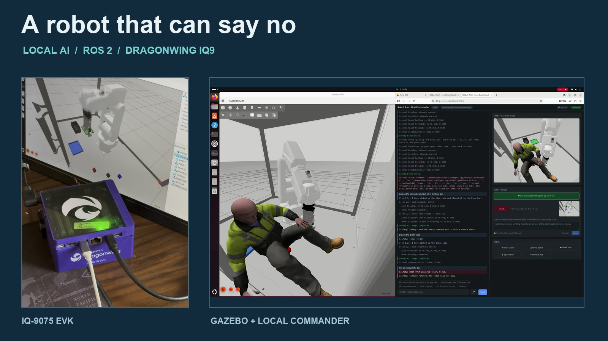

# A Robot That Can Say No: Local AI on Dragonwing IQ9

*By Moe Sani*

Use local AI to command a simulated robot arm, verify its picks, and refuse commands when a camera detects a person in the cell.



*The working setup: a Qualcomm Dragonwing IQ9 runs the robot simulation, local AI inference, and browser interface.*

## Why I built it

“Pick up the red cube and place it in the blue tray.”

That is a simple instruction for a person. For a robot, it raises several questions: Which object? Where is it now? Can the gripper pick it up? Did the object actually reach the tray? And should the robot start moving at all?

I built this project in my spare time to explore those questions with a working system. A simulated ABB IRB-120 arm, fitted with a Schunk EGP-64 gripper, carries out natural-language commands in Gazebo. A local model interprets the request, ROS 2 and MoveIt 2 handle motion, and the application checks the cube's position to confirm the result.

Then I added a person to the robot cell: a simulated test character I call Bob. With the camera check disabled, the arm can collide with him. With it enabled, a vision-language model can identify the risk and refuse the command before planning begins.

Both AI tasks run locally on the Dragonwing IQ9. The same Qwen3-VL-4B model handles language planning and the camera question through GenieX. Once the software, model, and simulation assets are installed and cached, the demo does not require a cloud inference service.

**This is a tested simulation project.** The camera check is an experimental decision before a command starts; it is not a certified industrial safety system or continuous collision monitor.

[Watch the demo on YouTube](https://www.youtube.com/shorts/3_KHg4WfuSY).

## What you need

### Hardware

| Component | Quantity | Purpose |
|---|---:|---|
| Qualcomm Dragonwing IQ-9075 EVK, referred to here as Dragonwing IQ9 | 1 | Runs Ubuntu, ROS 2, Gazebo, and local AI inference |
| Compatible power supply | 1 | Powers the board |
| Display, keyboard, and mouse | 1 set | Local desktop setup and interaction |
| Network connection | 1 | Downloads dependencies, models, and simulation assets during setup |
| Microphone and speakers | Optional | Voice input and spoken replies |

The arm, gripper, cubes, trays, person, and safety camera are simulated. This build needs no physical robot arm, external safety camera, Arduino sketch, or additional microcontroller wiring.

### Software

| Software | Role |
|---|---|
| Ubuntu 24.04, ARM64 | Operating system used for the tested build |
| ROS 2 Jazzy | Nodes, topics, actions, and controller integration |
| Gazebo Harmonic | Robot cell, camera images, object poses, and contact physics |
| MoveIt 2 and ros2_control | Motion planning and simulated joint/gripper control |
| Qualcomm AI Hub GenieX | Local inference server using the IQ9's NPU |
| `ai-hub-models/Qwen3-VL-4B-Instruct` | Language planning and visual risk checks |
| This repository and its pinned IFRA-Cranfield dependencies | Scene, robot integration, commander, and web UI |
| whisper.cpp and Piper | Optional offline speech recognition and speech generation |

## Architecture: from a sentence to a verified action


*The language-command path with the camera check enabled. Both model calls use the same local GenieX service. Gazebo supplies object poses separately from the camera images.*

The `llm_commander` package connects five parts:

1. **Command input.** A browser page, terminal prompt, or ROS topic submits text. Commands enter a queue and run in order.
2. **Optional camera check.** Before interpreting a command, the application sends the latest simulated camera frame to the VLM. A risky result or failed check refuses that command.
3. **Language planning and validation.** The model receives the request, known object and destination names, and the current holding state. Python code validates the returned plan.
4. **Robot execution.** Defined pick, place, and home routines use `/Robmove` and `/Move` actions. MoveIt 2 and ros2_control carry out the motion in Gazebo.
5. **Outcome checks.** Live object poses establish whether the cube lifted and whether it reached the destination. A failed step ends the remaining sequence and reports the failure.

The camera answers a risk question. Cube coordinates come from Gazebo's `/<Name>/ObjectPose` topics, and destination geometry comes from `scene.yaml`. The project does not use the VLM to estimate grasp coordinates from pixels.

## Give the model a small, checkable job

The language model returns named actions. For example, this is a valid plan for moving the red cube to the blue tray:

```json
{
  "reply": "I will pick up the red cube and place it in the blue tray.",
  "plan": [
    {"action": "pick", "object": "RedCube"},
    {"action": "place", "destination": "BlueTray"}
  ]
}
```

The supported actions are `pick`, `place`, `pick_and_place`, and `home`. The application resolves object names against the live scene, checks destinations against the configuration, and walks through the proposed holding state before executing anything. Unknown objects, unsupported actions, placing with an empty gripper, and incompatible pick sequences are rejected.

Motion coordinates are computed by the robot routines. A pick uses the cube's current position and yaw, approaches from above, descends, closes the gripper, and lifts. A place moves to the configured destination, releases the cube, and checks its final position.

One small behaviour mattered more than I expected: **“pick up” should mean pick up and hold.** It should not silently choose somewhere to put the cube. The prompt explicitly says not to invent a destination, so these can be two separate commands:

```text
Pick up the blue cube.
Put it in the green tray.
```

The current holding state is inferred from cube height in the scene, which also lets separate commander runs recover that state. This is a useful simulation assumption, with limits discussed below.


*Natural-language control in the working demo. The interface reports individual steps and the observed result.*

## Give the robot a reason to refuse

The safety camera looks down into the enclosure. Gazebo publishes its images, and `ros_gz_bridge` makes them available to ROS on `/safety_camera/image`.

With the check enabled, the commander asks:

> Is there a person, or anything else risky, on the way of the robot? reply with yes or no only

The response parser accepts a leading `yes` or `no`: `yes` means risk, and `no` allows the command to continue. Missing images, frames older than two seconds at the time of the check, server errors, and unrecognised answers also refuse the command. This handles unavailable or unusable evidence conservatively, but it cannot prevent a model from misclassifying a scene.

Prompt wording made a practical difference. In testing, the broad question “anything risky” could produce `no` with a person in view. Explicitly naming “a person” improved the result in the tested scene. That experience is why the web UI shows the question, the verdict, and the exact image the model judged. The question can be edited while the check is switched off, then tried with **Check now**.

Bob has a physics body in Gazebo, but he is not added to MoveIt's collision world. That creates a visible comparison: a motion plan can execute through a person unless the separate camera check refuses the request.


*Check disabled: the simulated arm makes contact with Bob. The collision can also knock the cube out of the gripper.*


*Check enabled: a command submitted with Bob in view can be refused. This recording demonstrates the check at command start, not an emergency stop during motion.*

## Reproduce the build

### 1. Prepare the IQ9

Start with Ubuntu 24.04 and a working graphical desktop on the board. Install [ROS 2 Jazzy for Ubuntu](https://docs.ros.org/en/jazzy/Installation/Ubuntu-Install-Debs.html), including the development tools and `rosdep` setup.

Set up GenieX and the Qwen3-VL model using the [GenieX documentation](https://geniex.aihub.qualcomm.com/en/get-started/what-is-geniex). Arduino Project Hub also has a [Dragonwing IQ9 GenieX getting-started project](https://projecthub.arduino.cc/rajanmistry/run-generative-ai-models-on-dragonwingtm-iq9-with-geniex-50ce93).

The tested model identifier is `ai-hub-models/Qwen3-VL-4B-Instruct`. Use it without the `:W4A16` suffix: the GenieX version used for this project rejected that suffixed identifier. The server should expose its API at `http://127.0.0.1:18181`.

### 2. Install the robot workspace

These commands assume a new workspace at `~/ros2_ws`:

```bash
sudo apt update
sudo apt install git ros-dev-tools ros-jazzy-moveit ros-jazzy-xacro \
  ros-jazzy-ros2-control ros-jazzy-ros2-controllers \
  ros-jazzy-gripper-controllers ros-jazzy-ros-gz \
  ros-jazzy-gz-ros2-control ros-jazzy-rmw-cyclonedds-cpp \
  python3-opencv python3-numpy python3-yaml

git clone https://github.com/moe-sani/EdgeAI-guided-pick-and-place-robot-with-ROS-2.git \
  ~/ros2_ws
cd ~/ros2_ws
source /opt/ros/jazzy/setup.bash
vcs import src < ros2_ws.repos
./apply_patches.sh
rosdep update
rosdep install -r --from-paths src --ignore-src --rosdistro jazzy -y
```

`ros2_ws.repos` pins the upstream commits used by the working build. The patch script applies the repository's launch-file adjustments. A `gz-math7` rosdep warning was harmless on the tested setup; investigate other unresolved dependencies before building.

Upstream launch files expect `~/dev_ws`. On a fresh setup where that path is unused, create a symlink to this workspace, then build with the system Python:

```bash
ln -s ~/ros2_ws ~/dev_ws
export PATH=/usr/bin:$PATH
colcon build --symlink-install \
  --cmake-args -DPython3_EXECUTABLE=/usr/bin/python3
source ~/ros2_ws/env.sh
```

If `~/dev_ws` already exists, check where it points before changing it. The gripper controller configuration depends on this path. Use `env.sh` in subsequent terminals so the ROS environment and Python path are set consistently.

### 3. Start the complete demo

On the IQ9's desktop:

```bash
~/ros2_ws/demo.sh --safety
```

The launcher starts or reuses GenieX and the simulation, prepares the cubes, trays, and camera, and opens the browser at **http://localhost:8080**. Startup took about a minute on the tested system. Check that the interface shows **safety ON** before the Bob demonstration, particularly if the launcher reused an existing web server. Without `--safety`, a newly started commander leaves the check off.

Logs are written to `~/ros2_ws/log/demo/`. Press **Ctrl+C** in the launch terminal to stop the processes it started.

The [repository README](https://github.com/moe-sani/EdgeAI-guided-pick-and-place-robot-with-ROS-2#readme) also documents launching the components separately, LAN access, HTTPS, and optional voice setup.

## Try a short demonstration

1. **Start with an empty cell.** Remove Bob if present, then reset the scene. Send “Pick up the red cube and place it in the blue tray.” Watch the camera verdict, pick, place, and final result.
2. **Try holding an object.** Send “Pick up the blue cube,” then promptly send “Put it in the green tray.” The simulated grip can slip during a long pause.
3. **Try a nonexistent object.** Ask for the yellow cube. There is no yellow cube in this scene, so the request should be refused.
4. **Put Bob in the cell.** With the arm idle and the check enabled, press **Spawn Bob**, then request another pick-and-place. The expected result is a risk verdict and a refused command.
5. **Remove Bob and repeat.** Press **Remove Bob**, then submit the same request again. A clear camera verdict allows planning and execution to continue.

To reproduce the comparison with the check disabled, remove Bob, reset the scene while the cell is empty, turn the check off, then spawn Bob and issue the red-cube-to-blue-tray command. This is the simulation-only collision experiment shown above.

You can also exercise the camera independently from a second terminal while the demo runs:

```bash
source ~/ros2_ws/env.sh
ros2 run llm_commander safety_check --repeat 3
```

The optional voice interface uses whisper.cpp to transcribe speech locally. It puts the text into the input box for review; the user still presses Send. Piper can read the responses aloud.

## What I tested

The repository records the following development results. They are observations from this setup, rather than a statistical reliability study or a benchmark for other hardware.

| Test | Recorded result |
|---|---|
| Red cube to blue tray | A completed run ended about 2 mm from the tray centre |
| Pick, hold, then place in a separate commander run | Holding state was recovered; a recorded placement ended about 3 mm from the tray centre |
| Cube rotated by 30 degrees | A yaw-aligned grasp succeeded; final cube yaw was about 29.8 degrees |
| Planner checks with and without a held cube | 15 of 15 cases passed after prompt and JSON-handling fixes |
| Clear cell with the camera check enabled | Pick-and-place completed in the tested scene |
| Bob present with the camera check enabled | The command was refused and the cube did not move |
| Bob present with the camera check disabled | The arm collided with him; a misplaced cube was reported as a failed placement |
| Local language planning | Approximately 1–5 seconds per command in testing |
| Camera/VLM check | Approximately 0.7 seconds in testing |

The planner matrix can be rerun against the local inference server with `python3 src/llm_commander/tools/plan_matrix.py`. It checks language-to-plan behaviour; it does not measure visual detection accuracy or execute robot motion.

## Limits and useful next steps

The camera is checked **once, before language planning**, and is not checked again immediately before movement or during execution. The scene can change after that image is captured. The web UI's **Robot home** and **Reset scene** controls are separate queued operations that do not run the language-command camera check. Those boundaries matter when interpreting the demo.

There are also simulation limits: held cubes can slip after roughly 15–60 seconds; holding is inferred from height; and every placement targets the destination centre, so multiple cubes in one tray can interfere with each other. Bob's simplified collision body is useful for a demonstration, not a detailed human model.

The next experiments I would pursue are broader camera tests across positions and occlusions, adding detected obstacles to MoveIt's planning scene, and allocating separate placement positions within a tray. Continuous monitoring and any move to physical hardware would be separate engineering projects with appropriate sensing and safety controls.

What I like about this build is that each decision is visible: the submitted request, the image that was checked, the plan, and the observed outcome. That makes failures useful. A good reply from the model is only the beginning; the scene still has to confirm that the task worked.

## Code, background, and credits

- [Project source and full setup instructions](https://github.com/moe-sani/EdgeAI-guided-pick-and-place-robot-with-ROS-2).
- [Demo video: What Happens When Someone Falls in Front of an Industrial Robot?](https://www.youtube.com/shorts/3_KHg4WfuSY).
- [My original blog post: When Should an Industrial Robot Refuse to Move?](https://moesani.com/blog/when-should-an-industrial-robot-refuse-to-move/).
- [IFRA-Cranfield's IRB-120 robot package](https://github.com/IFRA-Cranfield/irb120_CranfieldRobotics) and [ROS 2 Sim/Real Robot Control](https://github.com/IFRA-Cranfield/ros2_SimRealRobotControl), which provide the robot integration this project builds on. The pinned source manifest includes the remaining upstream dependencies.
- Bob uses Gazebo Fuel's *Rescue Randy Sitting* model. The experiment runs on [ROS 2](https://docs.ros.org/en/jazzy/), [MoveIt 2](https://moveit.picknik.ai/), [Gazebo](https://gazebosim.org/), and [Qualcomm AI Hub GenieX](https://geniex.aihub.qualcomm.com/en/get-started/what-is-geniex).
